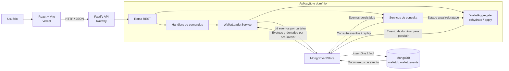
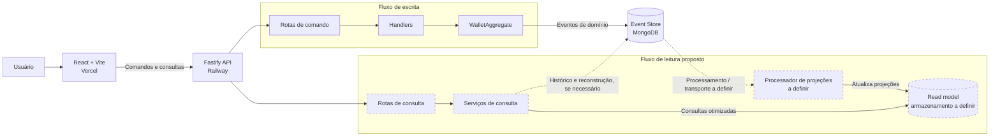

# Visão geral da arquitetura

Este documento descreve a arquitetura atual do Event Wallet e uma possível evolução para CQRS. A arquitetura futura é uma proposta associada à [ADR-0005](../adr/0005-adopt-cqrs-proposal.md); não representa comportamento implementado.

## Arquitetura atual

O frontend React chama a API Fastify por HTTP. A API grava eventos no MongoDB e reconstrói o estado atual da carteira por replay. Consultas de histórico também leem os eventos persistidos.

### Características observadas

- O Event Store é a fonte dos eventos de domínio.
- `WalletAggregate.rehydrate` aplica os eventos para reconstruir o estado da carteira.
- Os eventos são armazenados na coleção `wallet_events`, agrupados por `aggregateId`.
- A leitura dos eventos do agregado é ordenada por `occurredAt`.
- As consultas da API compartilham o Event Store; ainda não há um read model persistido separado.

## Arquitetura futura proposta: CQRS

A proposta é manter o fluxo de escrita baseado em comandos e eventos e adicionar projeções para atender consultas. O Event Store continua como fonte autoritativa; o mecanismo de processamento e a persistência dos read models ainda precisam ser decididos.

### Pontos ainda não decididos

- Quais consultas usarão read models e quais continuarão lendo o Event Store.
- Como as projeções receberão os eventos e como tratarão ordenação e duplicidade.
- Qual será a tecnologia de armazenamento dos read models.
- Qual nível de consistência será aceitável entre eventos e projeções.
- Como monitorar, reparar e reconstruir projeções.

Consulte a [ADR-0005](../adr/0005-adopt-cqrs-proposal.md) para o contexto, as alternativas e as questões em aberto.
